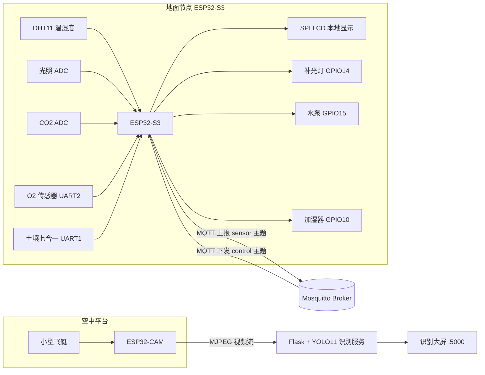
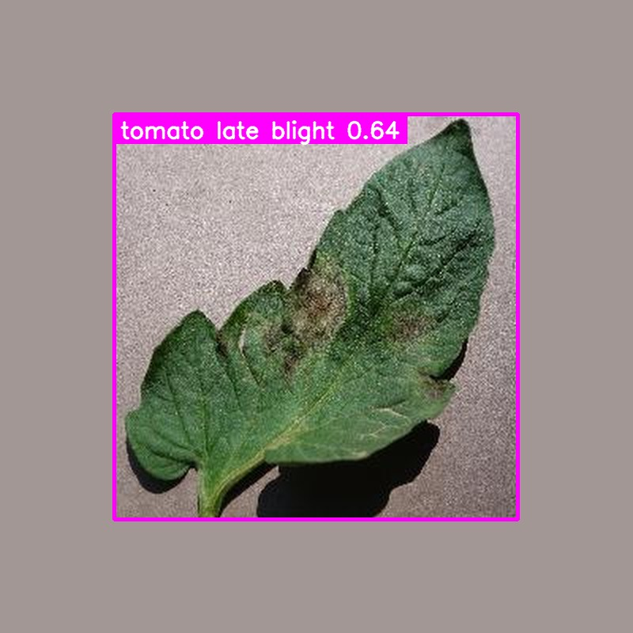

# 智能大棚空中一体监测系统

**空中巡检 + 地面感知**：小型飞艇搭载 ESP32-CAM 做叶片视觉巡检，ESP32-S3 地面节点采集空气/土壤/光照多参数并本地闭环控制，两者通过 MQTT 与 Flask 识别大屏汇成一套大棚立体监测系统。

<p align="center">
  
  
  
  
  
  
</p>

---

## 目录

- [系统组成](#系统组成)
- [核心功能](#核心功能)
- [系统架构](#系统架构)
- [效果预览](#效果预览)
- [硬件与接线](#硬件与接线)
- [目录结构](#目录结构)
- [快速开始](#快速开始)
- [通信协议](#通信协议)
- [自动控制策略](#自动控制策略)
- [实现要点](#实现要点)
- [已知限制](#已知限制)
- [体积与依赖说明](#体积与依赖说明)
- [作者](#作者)
- [License](#license)

## 系统组成

| 层 | 硬件 | 职责 | 对应代码 |
| --- | --- | --- | --- |
| 空中平台 | 小型飞艇 + ESP32-CAM | 空中游弋拍摄大棚叶片图像，输出 MJPEG 视频流 | `ai/`（流解析与识别） |
| 地面节点 | ESP32-S3（16 MB Flash） | 采集 5 类传感器、驱动 3 路执行器、LCD 本地显示、MQTT 上报与控制 | `firmware/` |
| 视觉中枢 | 上位机 Python | YOLO 病害识别 + OpenCV 兜底 + 识别大屏 | `ai/` |
| 数据总线 | Mosquitto Broker | 传感器数据上行、控制指令下行 | — |

> 📌 **仓库范围**：这里收录的是**地面节点固件**（`firmware/`）和**视觉识别服务**（`ai/`）。
> 空中平台（飞艇 / 无人机）的飞行控制、数字孪生可视化平台不在本仓库范围内。

## 核心功能

**地面节点（ESP32-S3 固件）**

- 多参数采集：空气温湿度、光照、CO₂、O₂、土壤湿度/温度/EC/pH/氮磷钾，每 1.5 s 一轮
- 本地闭环控制：补光灯、水泵、加湿器按阈值自动开关，支持 MQTT 远程 `on / off / auto` 三态切换
- SPI LCD 中文界面：实时数值 + Wi-Fi/MQTT 在线状态，脱网也能独立工作
- MQTT Broker 自动发现：优先复用上次地址，找不到就按 /24 子网逐个探测 1883 端口，换网络不用重新改代码
- 采集、显示、上传、控制各自跑在独立 FreeRTOS 任务里，靠队列解耦，单点阻塞不拖垮整机

**视觉中枢（Python）**

- YOLO 检测 → 关键词映射为 `pest / disease_spot / yellow_leaf / healthy / unknown` 五类通用语义，换模型不用改前端
- 分级置信度门限，弱命中时自动降阈值二次检测
- YOLO 全不命中时用 OpenCV HSV 找暗色病斑兜底，避免"永远健康"的假阴性
- Flask 单页大屏：实时视频流 + 类别/置信度/处理建议/最近截图，1 s 刷新

## 系统架构



## 效果预览

<p align="center">
  
</p>

<p align="center"><i>YOLO11 在番茄晚疫病叶片样本上的检测结果：<code>tomato late blight 0.64</code></i></p>

> 上方效果图与 `ai/static/demo_live.jpg`（演示模式的输入图）均取自 PlantVillage 数据集
> （Hughes & Salathé, 2015），沿用其 CC BY-SA 3.0 许可。

## 硬件与接线

> 引脚以 `firmware/components/BSP/` 下各驱动的宏定义为准，换板请同步修改。

### 传感器

| 传感器 | 接口 | 引脚 / 通道 | 说明 |
| --- | --- | --- | --- |
| DHT11 温湿度 | 单总线 | GPIO3 | 湿度 %RH，温度 ℃，失败自动重试 |
| 光照 | ADC | ADC1 通道 3 | 换算为 0~100 % 光强 |
| CO₂ | ADC | ADC1 通道 4 | 模拟电压换算 ppm |
| O₂ 传感器 | UART2 @9600 | TX GPIO16 / RX GPIO7 | 数值 ×10 存储，上报时除回 |
| 土壤七合一 | UART1 @9600 | TX GPIO18 / RX GPIO17 | 湿度、温度、EC、pH、N、P、K |

### 执行器与显示

| 外设 | 接口 | 引脚 | 说明 |
| --- | --- | --- | --- |
| 补光灯 | GPIO | GPIO14 | 高电平点亮 |
| 水泵 | GPIO | GPIO15 | 高电平启动 |
| 加湿器 | GPIO | GPIO10 | 高电平启动 |
| XL9555 IO 扩展 | I²C0 @400 kHz | SDA GPIO41 / SCL GPIO42 | LCD 背光、复位 |
| SPI LCD（2.4"） | SPI2 | SCLK GPIO12 / MOSI GPIO11 / MISO GPIO13 / CS GPIO21 / DC GPIO40 | 中文界面 |
| 板载 LED | GPIO | GPIO1 | 状态指示 |

## 目录结构

```
aerial-greenhouse-monitor/
├── firmware/                    # 地面节点固件（ESP-IDF v5.4 / ESP32-S3）
│   ├── main/                    # 程序入口 main.c
│   ├── components/
│   │   ├── APP/                 # 应用层：网络、MQTT、LCD 主业务
│   │   │   ├── COMMON/          # 统一数据结构 sensor_sample_t
│   │   │   ├── CONFIG/          # 配置模板 app_config.h
│   │   │   ├── MQTT/            # 上报与控制的 MQTT 客户端
│   │   │   ├── NETWORK/         # Wi-Fi 管理与 Broker 自动发现
│   │   │   └── SENSOR_APP/      # 采集/控制/显示主任务
│   │   └── BSP/                 # 板级驱动：DHT11、ADC、CO₂、O₂、土壤、LCD、XL9555、IIC、SPI
│   ├── tools/                   # 一键获取本机 MQTT 地址、订阅调试脚本
│   ├── partitions-16MiB.csv     # 16 MB Flash 自定义分区表
│   └── sdkconfig                # 已调好的工程配置（16 MB Flash、esp32s3）
├── ai/                          # 视觉中枢（Flask + YOLO11）
│   ├── app.py                   # MJPEG 视频流、状态接口、页面服务
│   ├── detector.py              # YOLO 推理、类别映射、HSV 兜底
│   ├── model/                   # YOLO 权重目录（见 model/README.md）
│   ├── static/                  # 样式与演示图片
│   └── templates/index.html     # 识别大屏
├── docs/images/                 # README 用图
└── README.md
```

## 快速开始

### 0. 准备

```powershell
git clone https://github.com/yuanjuna/aerial-greenhouse-monitor.git
cd aerial-greenhouse-monitor
```

### 1. 启动 MQTT Broker

```powershell
# 安装 Mosquitto 后，按需配置用户名密码
mosquitto -c "C:\Program Files\mosquitto\mosquitto.conf" -v
```

需要知道本机在局域网里的地址时，可直接跑仓库里的脚本（会打印地址并复制到剪贴板）：

```powershell
powershell -ExecutionPolicy Bypass -File firmware\tools\Get-MQTT-Address.ps1
```

### 2. 编译烧录固件

环境：**ESP-IDF v5.4**、目标芯片 **ESP32-S3**、Flash **16 MB**。

```powershell
cd firmware

# 填写 Wi-Fi / MQTT 账号：把下面的内容保存为
# components/APP/CONFIG/app_config_local.h（该文件已被 .gitignore 忽略）
#   #define WIFI_SSID                "你的热点名"
#   #define WIFI_PASS                "你的密码"
#   #define MQTT_KNOWN_BROKER_HOST   "192.168.1.100"
#   #define MQTT_DEFAULT_BROKER_HOST "192.168.1.100"
#   #define MQTT_PASSWORD            "你的MQTT密码"

idf.py build
idf.py -p COM10 flash monitor     # COM10 换成你的实际串口
```

> ⚠️ **不要执行 `idf.py set-target`**。仓库里的 `sdkconfig` 已经配好 16 MB Flash 与自定义分区表，`set-target` 会重置它导致分区表失效。

### 3. 启动视觉中枢

```powershell
cd ai
python -m venv .venv
.\.venv\Scripts\Activate.ps1
pip install -r requirements.txt

# 放置权重：ai/model/best.pt
# 详见 ai/model/README.md

python app.py
```

浏览器打开 <http://127.0.0.1:5000> 即可看到识别大屏。

默认跑**演示图片模式**（`ai/static/demo_live.jpg`），没有硬件也能看到完整界面；接上 ESP32-CAM 后关掉演示模式：

```powershell
$env:USE_DEMO_IMAGE = "0"
$env:CAMERA_URL = "http://192.168.1.50:81/stream"   # ESP32-CAM 的实际地址
$env:ENABLE_OPENCV_WINDOW = "0"                     # 无桌面环境时关闭本地预览窗口
python app.py
```

## 通信协议

### 上行：传感器数据

主题 `greenhouse/esp32s3_01/sensor`，周期约 1.5 s，QoS 0：

```json
{
  "dht_ok": true, "humidity": 62, "temperature": 26,
  "light_percent": 47,
  "air_CO2": 568, "air_O2": 20.9,
  "soil_ok": true, "soil_moisture": 38.5, "soil_temperature": 24.1,
  "soil_ec": 512, "soil_ph": 6.8,
  "soil_n": 42, "soil_p": 18, "soil_k": 96
}
```

`dht_ok` / `soil_ok` 为 `false` 时对应字段填 0，前端可据此显示"传感器故障"而不是误报数据。

### 下行：控制指令

主题 `greenhouse/esp32s3_01/control`，载荷是包含关键字与状态的字符串（不要求严格 JSON）：

| 载荷示例 | 效果 |
| --- | --- |
| `pump on` | 水泵强制开启 |
| `pump off` | 水泵强制关闭 |
| `pump auto` | 水泵回到阈值自动控制 |
| `humidifier on` / `atom on` | 加湿器强制开启（两个关键字等价） |
| `humidifier auto` | 加湿器回到自动控制 |

### Broker 自动发现

1. 先连 `MQTT_KNOWN_BROKER_HOST`（上次成功地址）
2. 失败则用 `MQTT_DEFAULT_BROKER_HOST` 所在 /24 网段逐个探测 1883 端口（约 180 ms/次）
3. 仍失败则每 10 s 重试一轮

这样换个场地演示时，只要手机热点网段一致，固件不用重编译。

## 自动控制策略

| 执行器 | 开启条件 | 关闭条件 | 最小切换间隔 |
| --- | --- | --- | --- |
| 补光灯 | 光照 < 45 % | 光照 > 30 % | — |
| 水泵 | 土壤湿度 < 30.0 % | 土壤湿度 > 45.0 % | 3 s |
| 加湿器 | 空气湿度 < 59 %RH | 空气湿度 > 60 %RH | 3 s |

带**回差（死区）**设计，避免数值在阈值附近抖动导致继电器反复吸合。

## 实现要点

- **任务解耦**：采集任务只往队列投递 `sensor_sample_t`，显示、上传、执行器各取所需，互不阻塞
- **DHT11 容错**：单总线器件偶发校验失败，连续失败 3 次才判定传感器离线，中间用重试掩盖抖动
- **类别语义映射**：`detector.py` 用关键词表把任意模型输出映射到 5 个通用类别，普通叶片类默认判为 `healthy`，换模型不改前端
- **弱命中二次检测**：首次置信度 0.25 无结果时降到 0.12 再检一次，由分类别门限（0.25~0.45）最终裁决
- **HSV 兜底**：YOLO 完全没框时，用绿色掩膜 ∩ 暗色掩膜统计病斑占比，占比超阈值才报 `disease_spot`，减少"永远健康"的假阴性
- **配置外置**：真实 Wi-Fi / MQTT 账号放在被忽略的 `app_config_local.h`，仓库里只留占位模板

## 已知限制

- 单节点设计，暂未支持多节点组网；主题里的 `esp32s3_01` 为固定设备号
- CO₂ 与光照走 ADC 模拟量，精度受电源噪声影响，量产需校准
- 视觉识别为"粗分类 + 兜底"策略，适用于巡检预警，不能替代农技人员确诊
- 演示模式与真实视频流共用同一套渲染逻辑，切换需要重启服务

## 体积与依赖说明

仓库只收录源码与文档，以下内容不随代码提交：

| 内容 | 体积 | 说明 |
| --- | --- | --- |
| YOLO 权重 `best.pt` | 20 MB ~ 460 MB | 见 `ai/model/README.md` |
| ESP-IDF 构建产物 `build/` | ~145 MB | 已忽略，`idf.py build` 可重新生成 |
| ESP-IDF 托管组件 `managed_components/` | ~1.2 MB | `idf.py build` 时自动下载 |
| Python 虚拟环境 `.venv/` | — | 按 `requirements.txt` 自行创建 |

## 作者

**yuanjuna** — [@yuanjuna](https://github.com/yuanjuna)

## License

[MIT](LICENSE)
